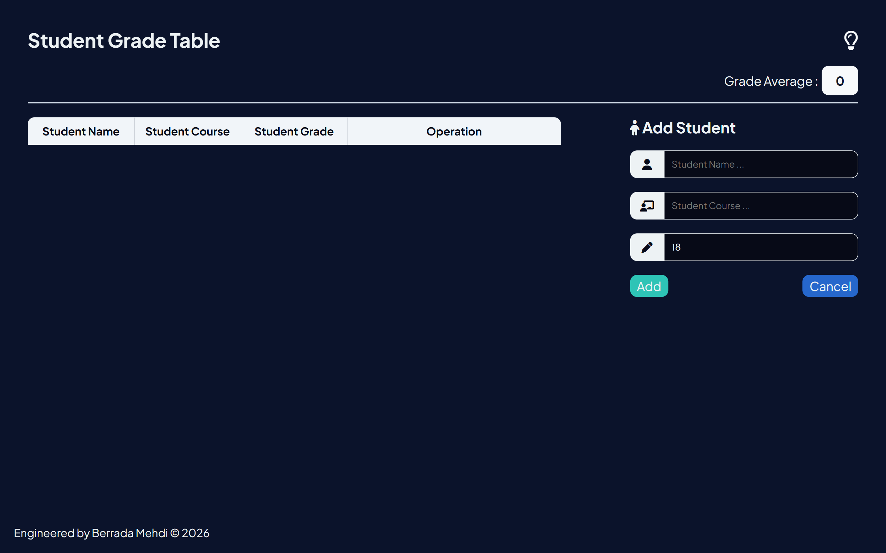
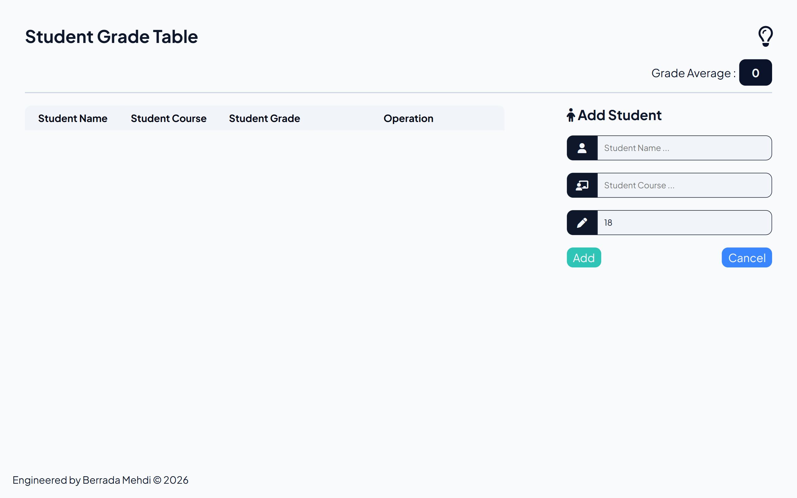
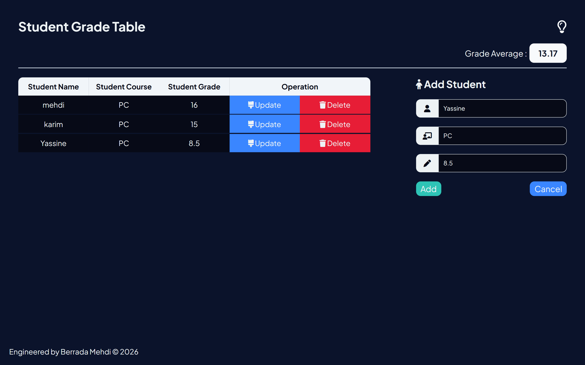

# Student Grade Table 🎓

A modern and responsive web application built with HTML5, CSS3, and Vanilla JavaScript designed to manage student records, track courses, calculate grade averages dynamically, and persist data using browser `localStorage`.

---

## 📱 App Interface & States

<p align="center">
    
  
  
</p>

---

## ✨ Features & Capabilities

- **CRUD Operations:** Easily add new student entries, update existing records, or delete specific students dynamically.
- **Dynamic Grade Average:** Automatically calculates and updates the overall grade average based on current student data.
- **Data Persistence:** Utilizes browser `localStorage` to ensure all student records and grades are safely saved across browser sessions.
- **Interactive UI & Notifications:** Smooth form controls, toggle operations, and clear feedback messages for user actions.
- **Modern Dark Theme:** Clean, data-dense, and ergonomic interface optimized for performance.

---

## 🛠️ Tech Stack

- **Markup:** HTML5
- **Styling:** CSS3 (Flexbox, Grid, Custom Properties)
- **Logic:** Vanilla JavaScript (DOM Manipulation, LocalStorage API, Event Handling)

---

## 🚀 Getting Started

### Prerequisites
A modern web browser (Google Chrome, Mozilla Firefox, Microsoft Edge, Safari).

### Installation
1. Clone the repository:
   ```bash
   git clone [https://github.com/berradamehdi/Student-Grade-JS.git](https://github.com/berradamehdi/Student-Grade-JS.git)